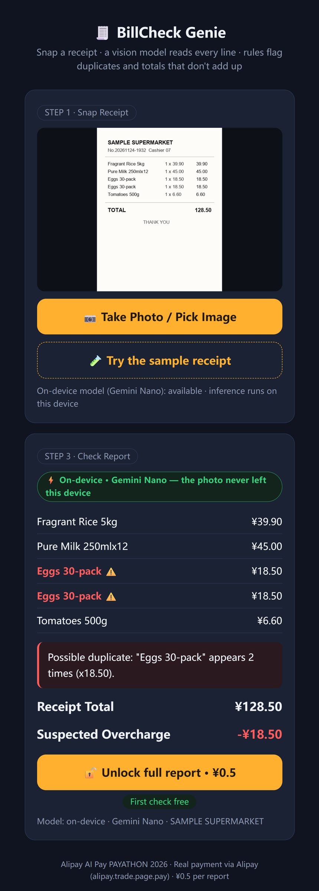
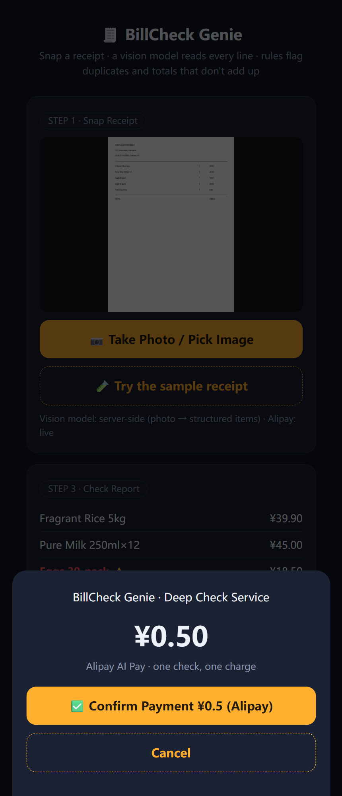

# BillCheck Genie

**Snap a receipt, get an AI audit of what you were overcharged — one check, one ¥0.5 payment.**

Built for **Alipay AI Pay PAYATHON 2026** (Vibe Pay / machine-pay track), **SLAY HACKS 2026** and **Google #BuildHybridAI 2026** (Firebase AI Logic, on-device Gemini Nano with a hybrid-API fallback).

| | |
|---|---|
| Live demo | https://billcheck-genie.app.workbuddy.host/?sharecode=2ACJTSLUWQ |
| Price | ¥0.50 per full report (server-side fixed, no client input) |
| Verification | Real Alipay trade `2026111922001493191431275587` · ¥0.50 · `TRADE_SUCCESS` |

> Access note: the hosting platform front-doors every page with a share code (anti-crawl). Open the **exact link above** — the bare domain intentionally shows a "link incomplete" page.

## What it does

1. **Snap** — take a photo of any paper receipt.
2. **Read** — a vision model transcribes every line item (name, qty, price) into structured JSON.
3. **Audit** — deterministic rules flag duplicate scans and totals that don't reconcile with the printed sum.
4. **Unlock** — the summary is free; the full report costs ¥0.50 through Alipay's cashier, one charge per check.





## How the AI works

There is no hard-coded report. The photo is turned into structured JSON by a vision model, and the app audits the numbers.

**Primary path — Firebase AI Logic, on-device inference (browser):**

```
photo (data URL)
   └─> Firebase AI Logic SDK  (InferenceMode.ONLY_ON_DEVICE)
          └─ Chrome's built-in Gemini Nano, via the Prompt API
                (multimodal input: the image is read on this machine)
   └─> strict JSON  ─>  auditReceipt()  ─> report + ⚡ on-device badge
```

**Why on-device only — a deliberate choice, not a limitation.** A receipt is a document with a shop,
a timestamp and a basket of what someone buys; uploading it to a hosted model is a real privacy cost
for a report that only needs arithmetic. Pinning `ONLY_ON_DEVICE` gives three things at once:
the photo never leaves the machine, there is no per-scan API cost, and the project needs no billing
account (Firebase **Spark** is enough — nothing is ever sent to the Gemini API). The hybrid API is
what makes this a one-line decision: the same `getGenerativeModel` call accepts
`PREFER_ON_DEVICE` / `ONLY_IN_CLOUD` / `PREFER_IN_CLOUD`, so the deployment target is a single enum,
not a rewrite. Verified with a DevTools network capture during a scan: the only outbound request is
the App Check token exchange — there is no `generativelanguage.googleapis.com` traffic.

**Fallback path — server proxy:** if the browser does not expose the on-device model (Safari, older
Chrome), or the AI Logic call fails, the same photo goes to `POST /api/scan`, which calls a vision
LLM from the server with the key kept server-side. The UI badge always says which path actually ran,
so nothing here is implied:

| badge | meaning |
| --- | --- |
| ⚡ On-device · Gemini Nano | Firebase AI Logic, inference ran locally |
| ☁️ Server-side model | on-device unavailable, server proxy handled it |

- **Code**: `app/hybrid-ai.js` (imports `firebase/ai`, sets `mode: ONLY_ON_DEVICE`, declares `expectedInputs` for text + image, reads `result.inferenceSource`) and `app/audit.js` (one audit implementation shared by browser and Node).
- **Prompt**: a fixed instruction pins the model to strict JSON and forbids inventing line items; unreadable values must be `null`.
- **Schema**: `{"merchant","currency","items":[{"name","qty","unit_price","amount"}],"total"}`
- **Audit**: `auditReceipt()` only does arithmetic — group identical names to surface duplicate scans, and compare the item sum against the printed total. It never guesses market prices.
- **Measured**: 13 s for a 5-line receipt on a laptop with the model already resident; ~4 s on the server proxy path.
- **Failure path**: an unreadable photo returns a plain "could not read this photo" message instead of a fabricated report.

The **Try the sample receipt** button runs the same audit rules on a built-in fixture and is labelled as such — it exists so judges can walk the payment flow without a paper receipt.

## On-device AI setup (Firebase AI Logic)

On-device vision needs **Chrome desktop** (stable, 138+) with
`chrome://flags/#prompt-api-for-gemini-nano-multimodal-input` enabled so the model accepts images;
without it the app falls back to the server proxy (the badge changes from ⚡ to ☁️).

```bash
# 1. Firebase project + AI Logic, Gemini Developer API provider.
#    No billing upgrade: on-device inference never reaches the Gemini API,
#    so the free Spark plan is sufficient.
# 2. Register a Web app, paste its config into app/firebase-config.js
# 3. AI Logic requires App Check. For local runs, a debug token is enough:
export FIREBASE_APPCHECK_DEBUG_TOKEN=true     # prints a token in the console; add it in
                                              # Firebase console -> App Check -> Manage debug tokens
```

`app/firebase-config.js` is optional: blank the `apiKey` and the app simply uses the server proxy,
so the demo never breaks.

## Payment integration

| Piece | Detail |
|---|---|
| Product | `alipay.trade.page.pay` (cashier redirect) |
| Amount | `0.50` hard-coded server-side; the client cannot pass a price |
| Signature | RSA2 (PKCS#1 private key), verified on every async notify |
| Notify | `POST /notify` → `checkNotifySign` → `app_id` + `total_amount` match → idempotent write (guarded by `paid_at`) |
| Return | `GET /return` → order status page, polls `/api/pay/status` |
| Refund | `POST /api/pay/refund` (partial allowed, capped at paid amount) + `/api/pay/refund/status` |
| Close | `POST /api/pay/close` for unpaid orders |
| Idempotency | `out_request_no` reused per order; notify handler is a no-op on replays |

## Run locally

```bash
npm install
# either put credentials in alipay.config.json (gitignored):
#   { "appId": "...", "privateKey": "...", "alipayPublicKey": "...", "publicBaseUrl": "...", "shareCode": "..." }
# or use environment variables:
export ALIPAY_APP_ID=... ALIPAY_PRIVATE_KEY=... ALIPAY_PUBLIC_KEY=... PUBLIC_BASE_URL=https://your-host
npm start            # http://localhost:3010
```

Without credentials the app still runs: `/health` reports `payConfigured:false` and checkout shows the verified live transaction instead of creating a real order.

Vision scanning needs the cloud LLM access key:

```bash
export WB_CLOUD_KEY=wbpk_...                       # publishable key for the app's cloud environment
export WB_CLOUD_ENDPOINT=https://your-app-host     # defaults to the hosted instance
export WB_CLOUD_MODEL=glm-5.3-flash                # any vision-capable model id
```

## Endpoints

| Method | Path | Purpose |
|---|---|---|
| GET | `/health` | `{ ok, payConfigured }` |
| POST | `/api/scan` | `{ image: dataURL }` or `{ text }` → items + findings + total |
| POST | `/api/pay/create` | creates the ¥0.5 order, returns cashier HTML |
| GET | `/api/pay/status` | poll trade state |
| POST | `/notify` | Alipay async notify (signature verified) |
| GET | `/return` | post-payment landing page |
| POST | `/api/pay/refund` | refund (≤ paid amount) |
| GET | `/api/pay/refund/status` | refund query |
| POST | `/api/pay/close` | close an unpaid order |

## Security notes

- The signing private key and the cloud LLM key stay server-side; `.gitignore` excludes `alipay.config.json`, `.orders.json`, `.env`.
- Amounts are never taken from the request body.
- Notify handlers verify the Alipay signature and re-check `app_id` and `total_amount` before marking an order paid.
- The app holds no payment credential able to move money out; refunds are capped at the paid amount.

## Limitations

- Receipt OCR is good on clean, well-lit photos; crumpled thermal paper still trips it up.
- Order state is a JSON file (`DATA_DIR`) — fine for a demo, would be a database in production.
- The public instance is intentionally locked to a fixed ¥0.50 price and cannot issue arbitrary charges.

## License

MIT — see [LICENSE](LICENSE).
